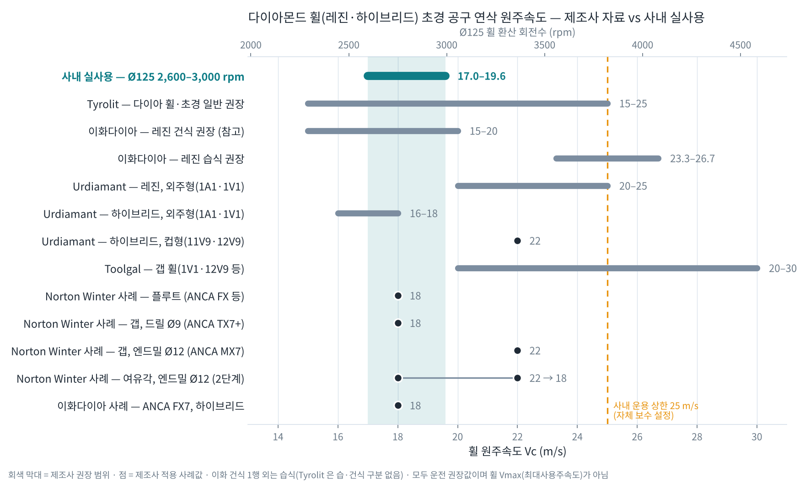
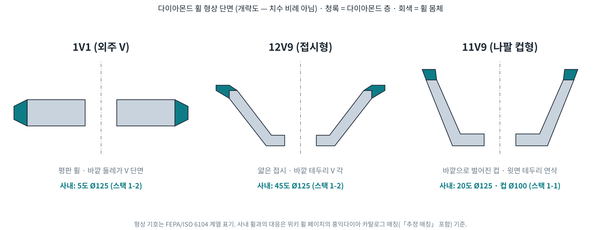

# 휠 원주속도 — 제조사 자료 vs 사내 실사용 (다이아몬드 휠 · 초경 공구 연삭)

> 목적: 사내 실사용 Ø125 휠 **2,600 ~ 3,000 rpm (17.0 ~ 19.6 m/s)** 이 제조사 자료로 보면 어디쯤인지 한 장에 비교한다. 계기: 파일럿 2기 발표 9번 질의응답 예시 ②(한경준님 2026-10-19 「어떤 게 맞는지 구별이 안 가니 자료를 찾아봐 달라, 사진 포함 비교」).
> ⚠️ 이 페이지의 수치는 모두 **운전 권장값·적용 사례값**이다. 휠이 견디는 한계인 **Vmax(최대사용주속도)가 아니다.** 보유 홍익다이아 휠 Vmax 는 아직 미확보 [[tools/wheels/index]].
> ⚠️ AI 가 모은 참고값이다. 조건을 바꿀 때는 **테스트 → 측정 → 검증** 후 적용(양산 바로 적용 금지).

## 1. 한눈에 보기

## 2. 휠 형상 — 사내 휠은 어느 형상인가

- 개략도는 Cowork 작성(치수 비례 아님). 사내 휠 대응은 각 휠 페이지의 홍익다이아 카탈로그 매칭 기준 — 20도·컵 Ø100 은 「추정 매칭」 [[휠-20도-Ø125-1-1]] · [[휠-45도-Ø125-1-2]] · [[휠-5도-Ø125-1-2]] · [[휠-컵-Ø100-1-1]]
- **실물 사진**은 저작권 때문에 위키(공개 저장소)에 넣지 않고 제조사 페이지 링크로 둔다:
  - 1V1 갭 휠: [Norton Winter G-Force 1V1 Gash](https://www.nortonabrasives.com/en-us/product/norton-winter-g-force-diamond-resin-bond-1v1-cnc-wheel-gash) · [Toolgal Gash Grinding (1V1·3V1·14V1·12V9 사진)](https://www.toolgal.com/project/gash-grinding/)
  - 11V9 컵: [Tyrolit 11V9 Ø100 레진 다이아 (SKS 판매 페이지)](https://www.shop-sks.com/en/TYROLIT-CNC-tool-grinder-with-resin-bonded-diamond-for-wet-grinding-DxDxH-100x35x20-For-carbide-shape-11V9-Art.-357223)
  - 12V9 접시: [Tyrolit 12V9 Ø125 (SKS 판매 페이지, 메탈 본드)](https://www.shop-sks.com/en/TYROLIT-CNC-tool-grinder-with-metal-bonded-diamond-for-wet-grinding-DxDxH-125x25x20-For-carbide-shape-12V9-Art.-34065415)
  - 사내 휠 실물: `raw/wheel/Cycle/홍익다이아 휠 제작.jpg` · `홍익다이아 휠 도면 참조.png`

## 3. 출처별 수치 (Ø125 환산 포함)

환산식: N(rpm) = 60,000 × Vc ÷ (π × D) · 예) 60,000 × 19 ÷ (π × 125) = 1,140,000 ÷ 392.7 = **2,903 rpm**

| 출처 | 대상 | Vc (m/s) | Ø125 환산 (rpm) | 신뢰도 |
|---|---|---|---|---|
| **사내 실사용** (2026-08-28 확정) | Ø125 레진 · 스택 1-2 | **17.0 ~ 19.6** | **2,600 ~ 3,000** | 사내 확인 |
| Tyrolit 정밀연삭 카탈로그 p.14·25·52 | 다이아 휠 · 초경 일반(습·건 구분 없음) | 15 ~ 25 | 2,292 ~ 3,820 | 제조사 기준 |
| 이화다이아 Grinding 2022 p.102 | 레진 다이아 **습식** | 23.3 ~ 26.7 | 3,565 ~ 4,075 | 제조사 기준 |
| 〃 | 레진 다이아 건식 (참고) | 15 ~ 20 | 2,292 ~ 3,056 | 제조사 기준 |
| Urdiamant (회전공구 연삭 휠) | **레진**, 외주형 1A1·1V1 (갭·여유각) | 20 ~ 25 | 3,056 ~ 3,820 | 제조사 기준 |
| 〃 | 하이브리드, 외주형 1A1·1V1 | 16 ~ 18 | 2,445 ~ 2,750 | 제조사 기준 |
| 〃 | 하이브리드, 컵형 11V9·12V9 | 22 | 3,361 | 제조사 기준 |
| Toolgal (갭 연삭 휠) | 1V1·3V1·14V1·12V9 | 20 ~ 30 | 3,056 ~ 4,584 | 제조사 기준 |
| Norton Winter 2023 p.18 사례 | 플루트, 초경 엔드밀 Ø4~16 (ANCA FX 등), 레진 D54 | 18 | 2,750 | 제조사 사례 |
| Norton Winter 2023 p.30 사례 | 갭, 초경 드릴 Ø9 (ANCA TX7+), 레진 D64 | 18 | 2,750 | 제조사 사례 |
| Norton Winter 2023 p.30 사례 | 갭, 초경 엔드밀 Ø12 (ANCA MX7), 레진 D64 | 22 | 3,361 | 제조사 사례 |
| Norton Winter 2023 p.34 사례 | 여유각, 초경 엔드밀 Ø12 (ANCA MX7) | 22 → 18 (2단계) | 3,361 → 2,750 | 제조사 사례 |
| 이화다이아 p.045 사례 | ANCA FX7, 초경 2날, 하이브리드 | 18 | 2,750 | 제조사 사례 |

- Norton 사례의 휠 직경은 카탈로그에 없음 → rpm 은 Ø125 로 가정한 환산(비교용).
- 쿨런트: Norton 사례는 모두 **오일**. Urdiamant·Toolgal 은 「참고값, 적용별 테스트 필요」로 명시.
- Toolgal: 속도를 올리면 휠이 더 일하고 냉각이 더 필요, 낮추면 마모가 빨라지는 대신 냉각 부담이 적다고 설명.

## 4. 읽는 법 — 「어느 게 맞나」

1. **정답 하나는 없다.** 같은 「다이아 휠·초경」이라도 본드(레진/하이브리드)·형상(외주형/컵형)·공정(플루트/갭/여유각)에 따라 제조사가 15 ~ 30 m/s 까지 넓게 제시한다.
2. **사내 17.0 ~ 19.6 m/s 는 모든 범위와 겹친다 — 단, 아래쪽이다.** ANCA 장비 적용 사례(Norton·이화)가 가장 많이 쓴 값 **18 m/s(Ø125 ≈ 2,750 rpm)** 가 사내 범위 한가운데에 있다.
3. **레진 전용 권장값은 사내보다 높다.** Urdiamant 레진 20 ~ 25 · 이화 레진 습식 23.3 ~ 26.7. 사내 휠은 홍익 **레진**이므로 제조사 기준으로는 올릴 여지가 있다 [추정값]. 반대로 사내 범위는 **하이브리드** 권장(16 ~ 18)·ANCA 사례(18)와 더 잘 맞는다.
4. **갭 공정은 18 ~ 22 m/s 사례가 있다.** 사내 Ø125 갭 휠(20도·45도·5도)의 2,600 ~ 3,000 rpm 은 그 아래 절반(18 m/s 쪽)이다.
5. 올릴지 말지는 이 페이지로 정하지 않는다. 올리려면 ① 홍익다이아 **Vmax 확인**(선결) ② 사내 상한 25 m/s(3,820 rpm) 이내 ③ 1단계씩 테스트(버닝·치핑·스핀들 부하·표면) → 측정 → 검증.

## 5. 발표 9번 예시 ② 답 보강안

- Q. Ø125 휠, 원주속도 19 m/s 면 RPM 은?
- A. N = 60,000 × 19 ÷ (π × 125) ≈ **2,903 rpm** · 사내 실사용 2,600 ~ 3,000 rpm 안 · 제조사 ANCA 적용 사례 18 ~ 22 m/s(2,750 ~ 3,361 rpm)와도 겹침 · 레진 휠 제조사 권장(20 ~ 25 m/s)보다는 낮은 보수적 운용 · 사내 운용 상한 25 m/s = 3,820 rpm

## 6. 한계

- Tyrolit 공구연삭 전용 장(p.114~137)은 이번에 확인하지 못함 — 일반값(15 ~ 25)만 반영. **확인 필요**.
- 홍익다이아(보유 휠 제조사)의 권장 원주속도는 자료 미확보 — **확인 필요**.
- 업계 칼럼의 「25 ~ 35 m/s 실무 sweet spot」 [IND-BADGER-GD] 은 보조 참고(단독 근거로 쓰지 않음).

## 관련 페이지

- [[tools/wheels/index]] — 원주속도 기준 정정 이력(18 m/s 는 하한이 아니라 사례 최빈값)
- [[catalog/이화다이아-카탈로그]] §4.3 · [[휠RPM-정책-검증-노트]] · [[projects/파일럿2기-발표-소재-모음]] §5
