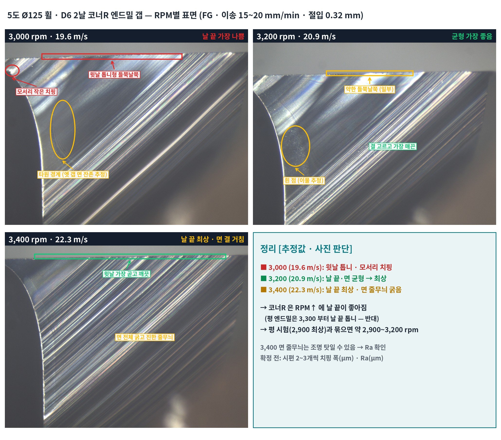
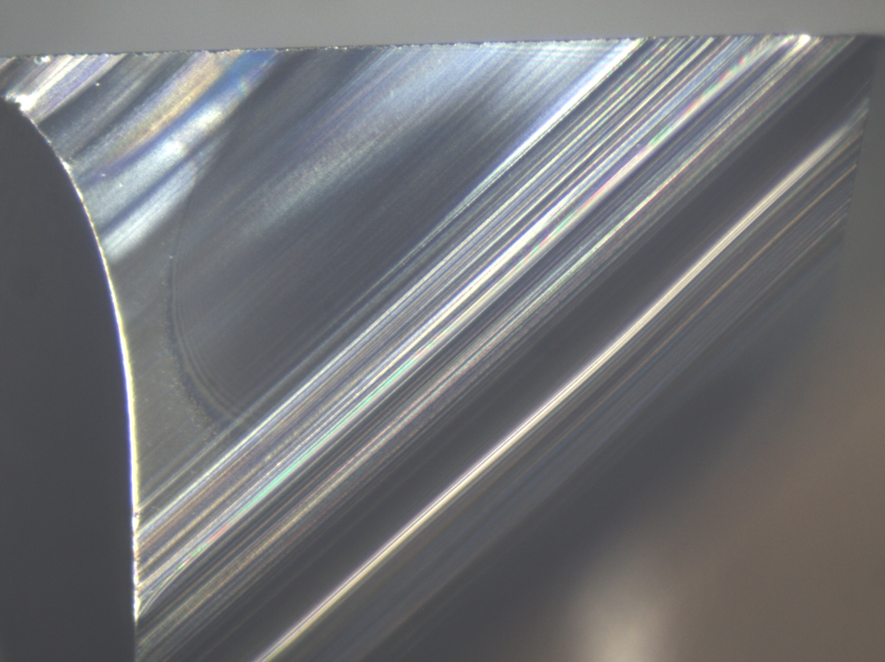
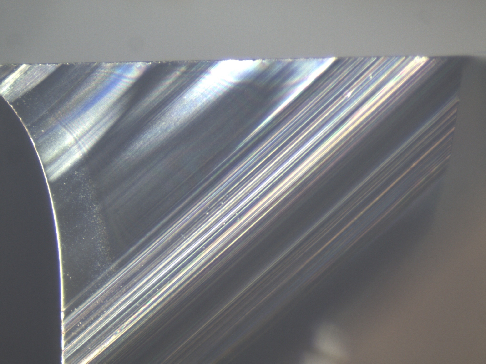
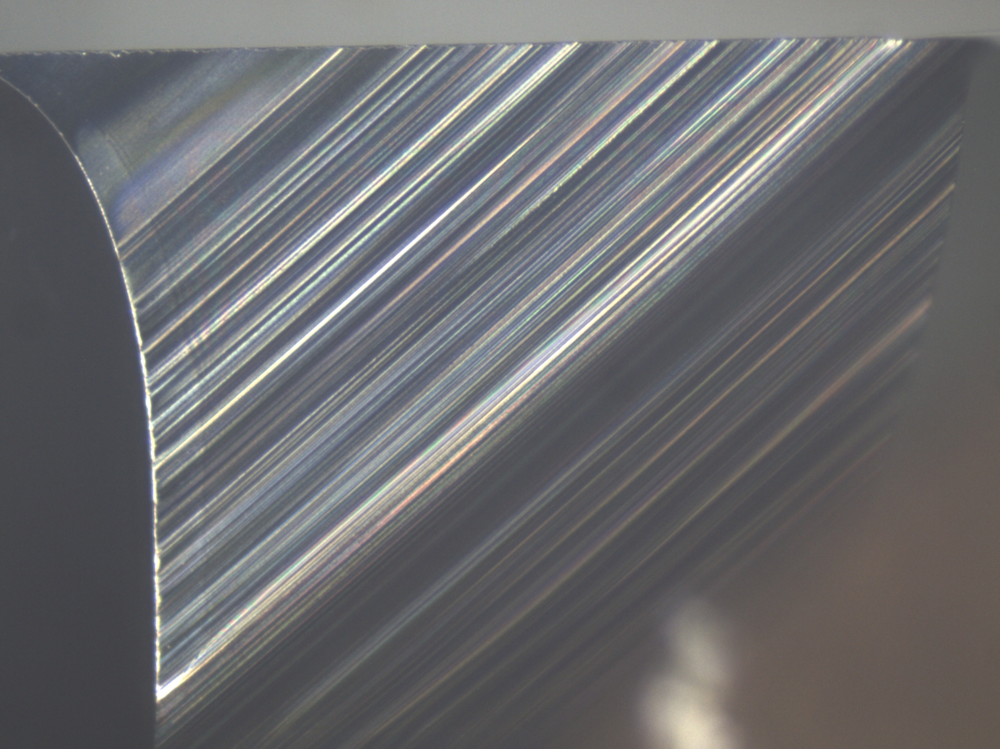
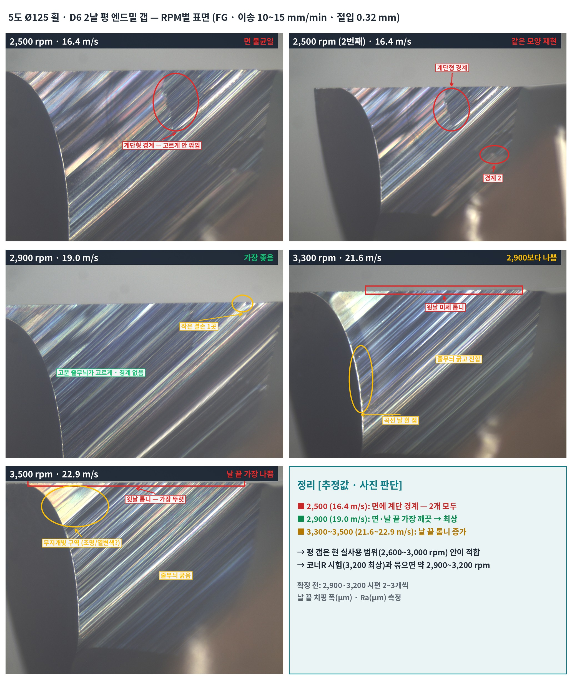
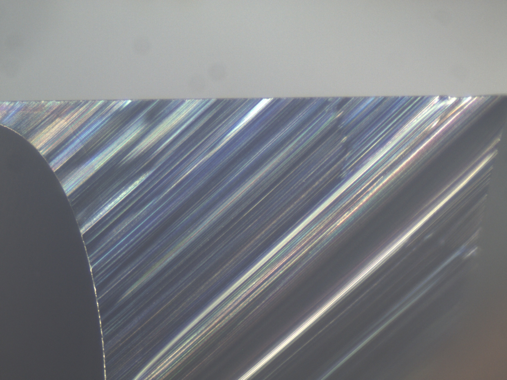
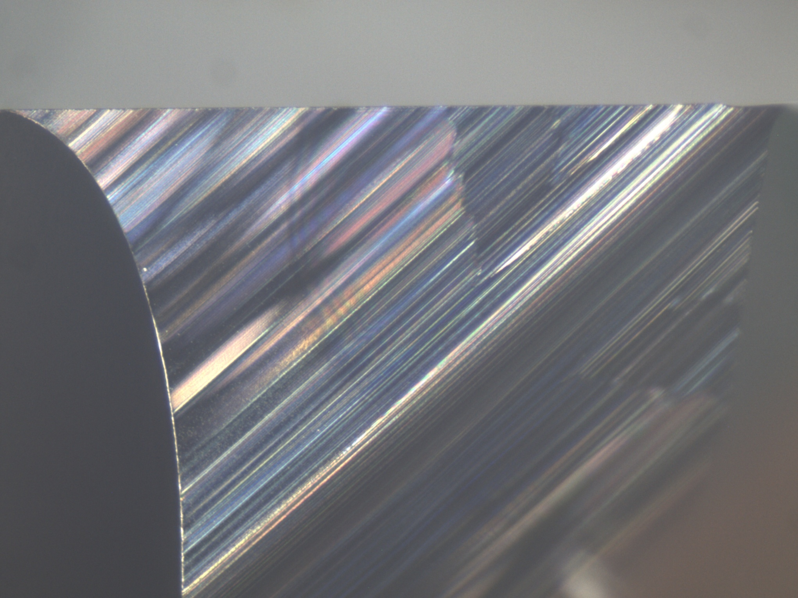
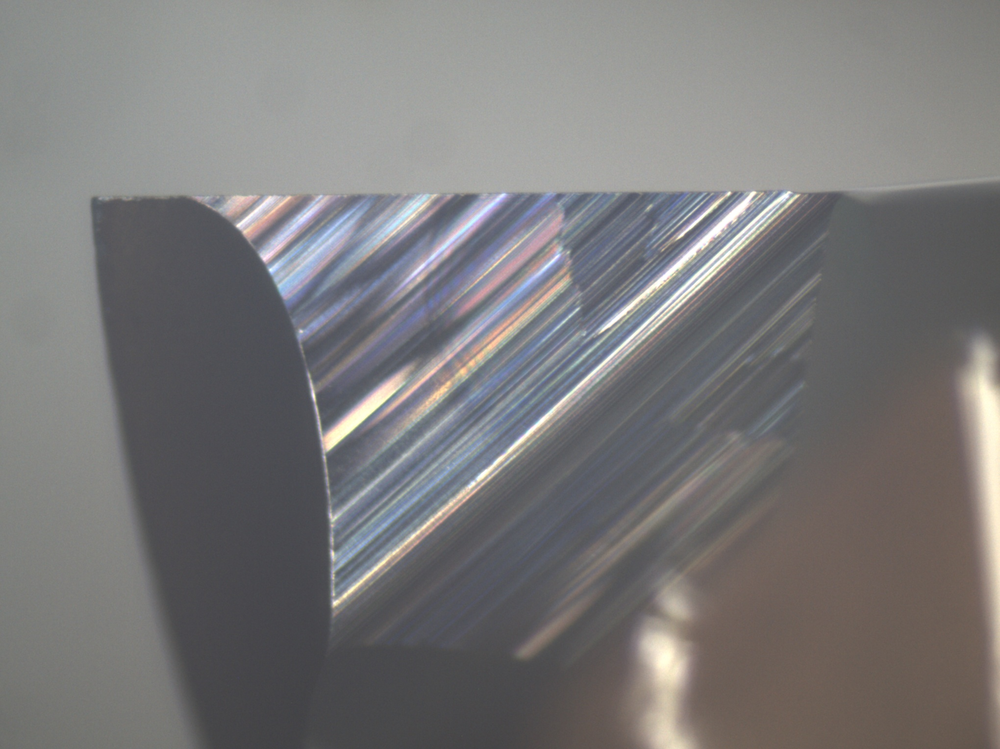
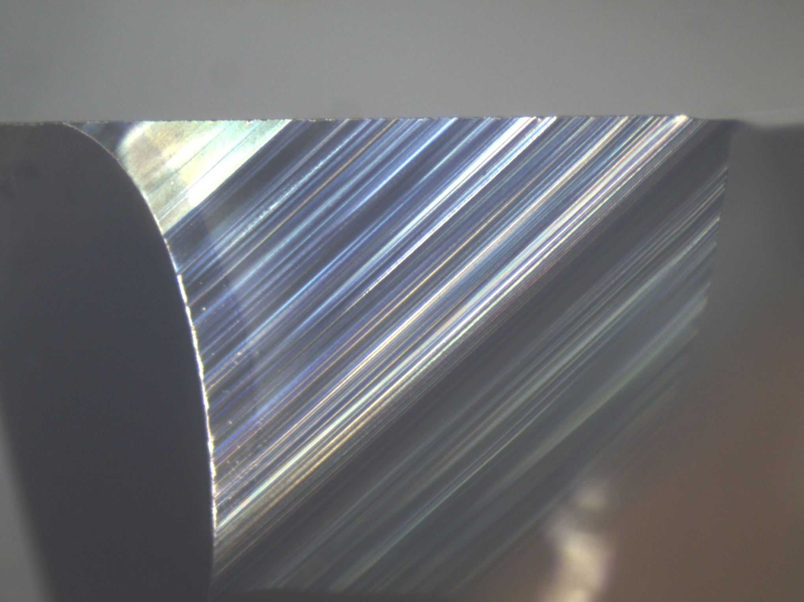
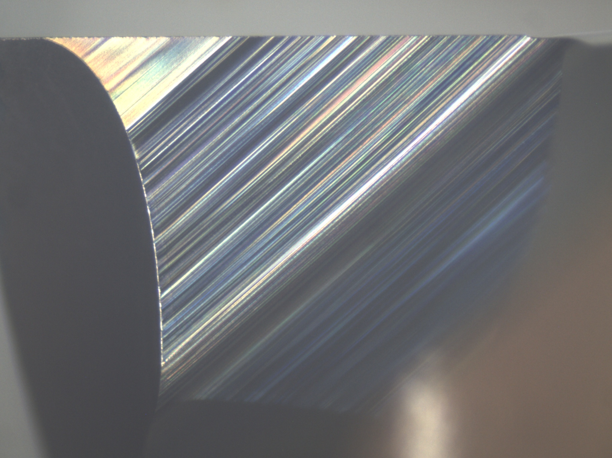

# 휠 5도 (Ø125, #400 / 스택 1-2)

스택 1-2에 장착되는 사다리꼴 단면 앵글 휠. 평 엔드밀 End Face Gash (D10, D4) 전용.

## 1. 기본 제원

| 항목 | 값 |
|------|---|
| 형상 | 사다리꼴 단면 |
| 휠 직경 (mm) | Ø125 |
| 두께 T (mm) | 5 |
| 각도 | V 5° |
| 코너 R (mm) | R1/R2 0.102 |
| Flipped | O (뒤집어 장착) |

## 2. 연삭재 · 결합재

| 항목 | 값 |
|------|---|
| Grit | #400 |
| Bond | — (정보 미제공) |
| Abrasive | 다이아몬드(D) |
| 결합도 | R (HID 최고 경도 등급 / J→L→N→P→R) |
| 집중도 | C125 (5.5ct/cc, 높은 집중도) — 환산값은 통용 기준 C100 = 4.4 ct/cm³ 비례 계산 **[추정값 — 1차 출처 미확인]** |

## 3. 원주속도 계산표 (Ø125) — 레진 본드 기준

> 🔴 **2026-09-09 정정 — Vmax 근거 표준이 바뀌었다 (수치 변경 없음).**
> 본 휠은 **레진 본드 초지립(superabrasive)** 이다(연삭재는 사내 기록상 **공란**이며 초경 연삭용이라
> 다이아몬드로 **추정** — 서면 미확인. 다만 **다이아몬드든 CBN 이든 모두 초지립**이므로 아래 결론은 동일하다).
> 종래 인용하던 **EN/ISO 12413:2019** 는
> 적용범위가 *"does not apply to super abrasive products"* 로 **초지립을 명시적으로 제외**한다 [STD-EN12413]
> [실측 검증 — BSI 제품 페이지, 2026-09-09]. 따라서 본 휠의 Vmax 근거 표준은 **EN 13236:2019
> 「Safety requirements for superabrasive products」** [STD-EN13236] 이며, oSa 표기 요건도 이 표준을 근거로
> **최대사용주속도(m/s) 제품 표기**를 요구한다 [STD-OSA-SUPER-MARK].
> ⚠️ **`ISO 12413` 이라는 번호 자체도 확인 필요** — sources.md 의 iso.org 링크가 404 이고 실재가 확인되는 것은
> **EN 12413:2019(CEN)** 다. ISO 판이 없다고 단정하지 않는다.
> ⚠️ **EN 13236 본문은 유료**라 레진 초지립 속도 클래스 실수치는 **미확보**다 — 추정하지 않는다.
> 기존 12413 인용은 삭제하지 않고 성격만 한정했다. 상세: `decisions.md` 2026-09-09 (3).

| RPM | 원주속도 (m/s) | 판정 |
|-----|---------------|------|
| 2,600~3,000 | 17.0~19.6 | 🟢 **사내 실사용** (2026-08-28 확인) |
| 2,750 | 18.1 | ~~레진 하한 (권장 최소)~~ → 사내 실사용 안 · 제조사 사례 최빈값(18 m/s) 부근 |
| 3,000 | 19.6 | ~~권장 구간~~ → 사내 실사용 상단 |
| 3,500 | 22.9 | ~~권장 구간~~ → 사내 상한 이내 · 실사용 밖 |
| **3,820** | **25.0** | ~~레진 상한 ← 최대 허용 RPM~~ → **사내 운용 상한 — 넘지 않음** (자체 보수 설정 · 휠 Vmax 미확보) |
| 4,000 | 26.2 | ⚠️ 초과 — 사용 금지 |
| 6,000 | 39.3 | ~~🚫 위험 — 휠 파손/버닝~~ → 🚫 **사용 금지** — 사내 상한 · 이화 레진 습식 권장 상한(26.7 m/s) 모두 초과 |

> ~~⚠️ **레진 본드 제한**: Vc 25 m/s 초과 시 결합재 열화 및 휠 파손 위험. Ø125 기준 **최대 3,820 rpm**. 장비 최대(6,000 rpm) 절대 사용 금지.~~
>
> ⚠️ **사내 운용 상한 25 m/s (Ø125 기준 3,820 rpm) — 넘지 않는다.** 결합재의 물리적 한계가 아니라 자체 보수 설정이며, 휠의 최대사용주속도(Vmax) 표기를 아직 받지 못했으므로 이 선을 지킨다. 프로그램 입력 상한 6,000 rpm 은 사용 금지.
>
> 🔄 **2026-10-16 판정 이름 정정** — 숫자(RPM·m/s)와 사내 상한 25 m/s 는 그대로, 옛 판정 이름은 취소선으로 보존. 근거: [[index]] §원주속도 기준 정정 ①② (2026-08-28 — 18 m/s 는 하한이 아니라 제조사 사례 최빈값 · 25 m/s 는 본드의 물리적 한계가 아니라 사내 운용 상한) · decisions.md 2026-10-16 (2)

## 4. 사용 이력

| 공구 | 공정 | RPM | 원주속도 | 상태 |
|------|------|-----|---------|------|
| D10 2날 평 엔드밀 | End Face Gash | 4,000 | 26.2 m/s | 권장 목표 |
| D4 2날 평 엔드밀 | End Face Gash | 4,000 | 26.2 m/s | 테스트 중 (RPM 4,000 개선 확인) |

> 신뢰도: **사내 경험값** — 현장 운용 기록(2026-04-21 대화 정리) 기준, 계측 검증 전. 원주속도는 RPM·휠 직경으로 계산한 값. [검수 추가 2026-09-23]
>
> ⚠️ 주의: 두 행 모두 **26.2 m/s(25 m/s 초과)** 로, 위 §3 표의 같은 조건(4,000 rpm)이 「⚠️ 초과 — 사용 금지」로 판정돼 있다. **미종결 사안으로 병기 유지 중**(decisions.md 2026-08-24 ②(a) — 홍익다이아 서면 회신 전까지 종결하지 않음). 이 행을 상한 완화의 근거로 쓰지 말 것.

## 5. 상태 이력

| 날짜 | 이벤트 | 내용 |
|------|--------|------|
| 2026-04-21 | 등록 | 대화에서 정리한 데이터 기반 최초 등록 |
| 2026-05-18 | 정합 보강 | [[홍익다이아-Flute-Gash-휠|1V1/3V1 V5°]] 카탈로그 매칭 + [[휠RPM-정책-검증-노트]] 학술 근거 추가 |
| 2026-10-19 | 시험 기록 | End Face Gash 3,000 · 3,200 · 3,400 rpm 사진 비교 → §6.4 (추정값, 3,200 균형 최상) |
| 2026-10-19 | 시험 기록 | D6 2날 평 갭 2,500 · 2,900 · 3,300 · 3,500 rpm 사진 비교 → §6.5 (추정값, 2,900 최상) |

## 6. ANCA 사내 적용 추적 (2026-05~)

> 본 섹션은 [[ANCA-사내적용-체크리스트-2026-05]]의 3항목 적용 결과를 본 휠에 기록하는 위치입니다.

### 6.1 iBalance 측정 ([[휠-밸런싱-iBalance]] Richardson 2022)

| 측정일 | 1차 불균형 | 추가 웨이트 | 2차 측정 | 판정 | 작업자 |
|--------|---------|--------|---------|------|------|
| __-__-__ | ___ g·mm | ___ g @ __° | ___ g·mm | OK/NG | |

### 6.2 Q'w 운영 ([[MRR-기반-연삭공정-분석]] Zaiser 2022 / [[연삭-테스트-방법]] Graf 2011)

권장 운영 범위: **Q'w 6 ~ 12 mm³/(mm·s)** (초경 엔드밀 End Face Gash)

| 가공일 | 공구 | Vw (mm/min) | Ae (mm) | Q'w 계산 | 판정 | 스핀들 부하 % |
|--------|------|-----------|--------|--------|------|----------|
| __-__-__ | D10 평 End Face Gash | _____ | _____ | _____ | 🟢/🟡/🔴 | _____ |
| __-__-__ | D4 평 End Face Gash | _____ | _____ | _____ | 🟢/🟡/🔴 | _____ |

### 6.3 사내 적용 결정값 (1개월 측정 후 결정)

| 항목 | 결정값 | 결정일 |
|------|-------|------|
| iBalance 합격 임계값 | _____ g·mm 이하 | __-__-__ |
| Q'w 운영 표준 | _____ ~ _____ mm³/(mm·s) | __-__-__ |
| Dressing 신호 임계 | 스핀들 부하 +___% 증가 시 | __-__-__ |

### 6.4 테스트 — 2026-10-19 / End Face Gash RPM 3,000 · 3,200 · 3,400 표면 사진 비교

| 항목 | 값 |
|------|-----|
| 장비 | ANCA FastGrind (FG) |
| 휠 | 본 휠 — 5도 Ø125 × T5 · V 5° · #400 · 레진 · C125 (스택 1-2) |
| RPM / Vc | 3,000 rpm / 19.6 m/s · 3,200 rpm / 20.9 m/s · 3,400 rpm / 22.3 m/s |
| Feed / Q'w | 15 ~ 20 mm/min (현장 표기 「20~15」) / Q'w 0.08 ~ 0.11 mm³/(mm·s) (계산: 0.32 × 15 ÷ 60 = 0.08 · 0.32 × 20 ÷ 60 = 0.107) |
| DOC / Ae | 0.32 mm |
| 쿨런트 | 미확인 |
| 피삭재·공구 | 초경 엔드밀 D6 2날 코너R (재연마) |
| 측정 장비 | 현미경 사진 (기종·배율 미확인) — Ra 미측정 |
| **결과** | 사진 판단만 — 아래 표 |

계산식 Vc = π × D × N ÷ 60,000 → π × 125 × 3,000 ÷ 60,000 = 19.63 · × 3,200 = 20.94 · × 3,400 = 22.25 m/s

| RPM | 날 끝(모서리) | 갭 면 | 사진 판단 |
|-----|--------------|-------|----------|
| 3,000 | 톱니형 들쭉날쭉 · 왼쪽 모서리 작은 치핑 | 결은 고운 편 · 가운데 타원형 경계선(옛 갭 면 잔존 추정) | 날 끝 가장 나쁨 |
| 3,200 | 3,000보다 깨끗 · 가운데 일부 약한 들쭉날쭉 | 결 고르고 가장 매끈 · 흰 점(이물 추정) 소수 | **균형 가장 좋음** |
| 3,400 | 가장 곧고 깨끗 | 면 전체에 굵고 진한 연삭 줄무늬 | 날 끝 최상 · 면 결 가장 거침 |

**표기본(한 장 요약):**

원본:

**신뢰도:** 추정값 — 사진 3장의 조명·초점·배율이 서로 다르고 시편 1개씩. 판단: Cowork, 사진 제공: 한경준님(2026-10-19)

- 세 시편 모두 **같은 드레싱 상태 · 같은 절입·이송** (한경준님 2026-10-19) → 사진 차이는 RPM 영향으로 본다. 단 3,000 의 타원 경계는 재연마 전 옛 갭 면 잔존일 가능성이 남아 있음 [추정값]
- 📌 이 휠의 기존 용도는 평 엔드밀(D10·D4) End Face Gash — 이번은 **D6 2날 코너R** 에 적용한 기록
- 🟡 Q'w 0.08 ~ 0.11 은 §6.2 「권장 운영 범위 6 ~ 12」와 두 자릿수 차이 — §6.2 범위가 이 공정(갭 Ae 정의)에 그대로 맞는지 **확인 필요**
- 3,200·3,400 rpm 은 Ø125 실사용(2,600 ~ 3,000 rpm)보다 높은 **신규 조건**. 사내 상한 25 m/s(3,820 rpm) 이내 · 제조사 갭 사례 22 m/s(Norton, ANCA MX7)와 같은 수준 → [[comparisons/휠-원주속도-제조사자료-비교-2026-10]]
- ⚠️ 위 §4 사용 이력의 「4,000 rpm (26.2 m/s) 권장 목표」와 다른 방향의 데이터 — §4 는 보존, 이번 결과로 갱신하지 않음
- 다음: 같은 배율·조명으로 날 끝 치핑 폭(μm) · 갭 면 Ra(μm) · RPM별 2~3개 · 드레싱 직후 · 스핀들 부하(%) 기록 → 결과가 나오면 「실측 검증」으로 올림

**설비 상태**
- 스핀들 런아웃: 확인 안 됨
- iBalance: 미실시
- 드레싱: 세 시편 동일 상태 (시점 미기록)
- 쿨런트 농도/pH: 미확인
- 예열: 미확인

**조건 변경 이력**

| 날짜 | 변경 내용 | 사유 | 양산 적용 |
|------|----------|------|----------|
| 2026-10-19 | 3,000 → 3,200 · 3,400 rpm 비교 시험 | 갭 면·날 끝 품질 비교 | 🔄 검증 중 (양산 미적용) |

### 6.5 테스트 — 2026-10-19 / End Face Gash RPM 2,500 · 2,900 · 3,300 · 3,500 (D6 2날 평) 표면 사진 비교

| 항목 | 값 |
|------|-----|
| 장비 | ANCA FastGrind (FG) |
| 휠 | 본 휠 — 5도 Ø125 × T5 · V 5° · #400 · 레진 · C125 (스택 1-2) |
| RPM / Vc | 2,500 / 16.4 · 2,900 / 19.0 · 3,300 / 21.6 · 3,500 / 22.9 m/s (가공 순서: 2,900 → 2,500 → 2,500(2번째) → 3,300 → 3,500) |
| Feed / Q'w | 10 ~ 15 mm/min (현장 표기 「15~10」) / Q'w 0.05 ~ 0.08 mm³/(mm·s) (0.32 × 10 ÷ 60 = 0.053 · 0.32 × 15 ÷ 60 = 0.080) |
| DOC / Ae | 0.32 mm |
| 쿨런트 | 미확인 |
| 피삭재·공구 | 초경 엔드밀 D6 2날 평 (재연마) |
| 측정 장비 | 현미경 사진 (기종·배율 미확인) — Ra 미측정 |
| **결과** | 사진 판단만 — 아래 표 |

계산식 Vc = π × 125 × N ÷ 60,000 → 2,500 = 16.36 · 2,900 = 18.98 · 3,300 = 21.60 · 3,500 = 22.91 m/s

| RPM | 날 끝(모서리) | 갭 면 | 사진 판단 |
|-----|--------------|-------|----------|
| 2,500 (2개) | 깨끗 | **두 시편 모두** 면 가운데에 계단형 경계(다른 결의 구역) — 한 번에 고르게 깎이지 않은 흔적으로 보임 | 면 균일성 가장 나쁨 · 재현됨 |
| **2,900** | 깨끗 · 오른쪽 끝 작은 결손 1곳 | 고운 줄무늬가 면 전체에 고르게 · 경계 없음 | **가장 좋음** |
| 3,300 | 윗날에 미세한 톱니형 들쭉날쭉 · 곡선 날에 흰 점 | 줄무늬 굵고 진함 · 왼쪽 위 모서리 결이 다른 구역 | 2,900보다 나쁨 |
| 3,500 | 윗날 톱니형 들쭉날쭉 가장 뚜렷 | 줄무늬 굵음 · 왼쪽 위 무지개빛 구역(조명 또는 열변색 — 구분 불가) | 가장 나쁨(날 끝) |

**표기본(한 장 요약):**

원본:

**신뢰도:** 추정값 — 사진 판단 · 조명·배율 불균일 · 2,500 외 시편 1개씩. 같은 장비·휠·이송·절입·드레싱(한경준님 2026-10-19)

- §6.4(D6 2날 코너R, 3,000~3,400)와 묶어 보면: 코너R 은 **3,200**, 평은 **2,900** 이 가장 좋아 보임 → 두 공구 모두 **약 2,900 ~ 3,200 rpm (19 ~ 21 m/s)** 부근이 좋고, 위아래로 벗어나면 나빠지는 모양 [추정값]
  - 아래쪽(2,500 = 16.4 m/s): 면이 고르게 안 깎임(계단 경계) — 2개 시편에서 재현
  - 위쪽(3,300 ~ 3,500 = 21.6 ~ 22.9 m/s): 평에서는 날 끝 톱니가 늘어남 — 코너R(3,400 날 끝 깨끗)과 반대 경향
- 2,900 rpm 은 현재 실사용 범위(2,600 ~ 3,000 rpm) 안 → 평 엔드밀 갭은 **지금 범위가 맞는 쪽** 이라는 사진 근거 1건
- ⚠️ 위 §4 「D10·D4 평 End Face Gash 4,000 rpm(26.2 m/s) 권장 목표」와 반대 방향 — §4 는 보존
- 🔎 신뢰도 검토(외부 자료 비교·다음 시험 설계): [[comparisons/5도휠-갭-RPM시험-신뢰도-검토-2026-10]]
- 다음: 2,900 · 3,200 두 값만 시편 2~3개씩 → 날 끝 치핑 폭(μm) · 갭 면 Ra(μm) · 같은 배율·조명으로 비교

**설비 상태**
- 스핀들 런아웃: 확인 안 됨 · iBalance: 미실시 · 드레싱: 시편 간 동일(시점 미기록) · 쿨런트: 미확인 · 예열: 미확인

**조건 변경 이력**

| 날짜 | 변경 내용 | 사유 | 양산 적용 |
|------|----------|------|----------|
| 2026-10-19 | D6 평 갭 2,500 · 2,900 · 3,300 · 3,500 rpm 비교 시험 | 갭 면·날 끝 품질 비교 | 🔄 검증 중 (양산 미적용 · 2,900 은 기존 범위 안) |

## 관련 페이지

### 스택·동반 휠
- [[스택-1-2]] — 장착 스택
- [[휠-45도-Ø125-1-2]] — 스택 1-2의 2번 포지션 휠
- [[휠-컵-Ø100-1-2]] — 스택 1-2의 3번 포지션 휠

### 카탈로그 매칭 (추정)
- [[홍익다이아-Flute-Gash-휠]] — **1V1 V5° 또는 3V1 V5°** (HID 카탈로그 p.7~8). V각도 1단계(5°) 일치. T=8 카탈로그 표준 / T=5 본 휠 → 두께 커스텀
- [[홍익다이아-형상-분류]] — 1V1 (V각도 스트레이트) / 3V1 (V각도 프로파일) 단면 비교
- [[tools/wheels/catalog/index|홍익다이아 카탈로그 인덱스]]

### 운영 정책 검증
- [[휠RPM-정책-검증-노트]] — Resin Bond Diamond 휠 Vc 18-25 m/s 정책 학술 근거. **본 휠 §3 원주속도 표 Norton Winter 1차 출처와 일치**
- [[index|휠 카탈로그]]
